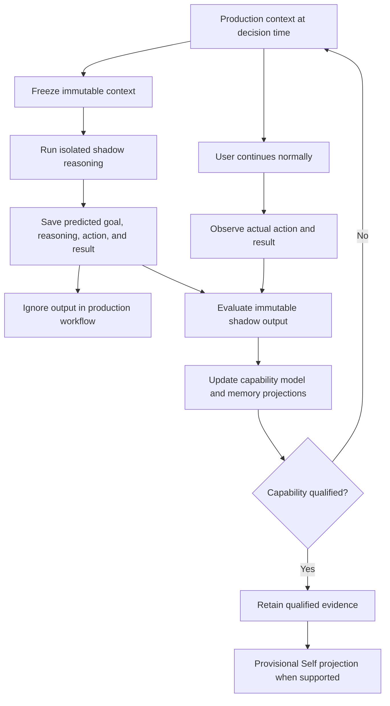

# Shadow Agent Technical Design

> **Agency removed (2026-10-13):** The production Agency, all but eight of its
> tables (see AGENTS.md), and its design documents (`AGENCY_*`, `DESK_*`,
> `FIRST_RUN_*`, including the former canonical
> `AGENCY_SYSTEM_TECHNICAL_DESIGN.md`) were removed. Git history keeps the
> documents: `git log --diff-filter=D -- 'wails-gui/AGENCY_*.md'
> 'wails-gui/DESK_*.md' 'wails-gui/FIRST_RUN_*.md'`.
> This document remains the detailed record of the existing ShadowRun,
> correlation, capability, authority, Self, and debugger implementation. Its
> proposal-shaped Initiative lifecycle is legacy design: new ShadowRuns mirror
> detected Task Episodes, and shadow qualification never creates a proposal or
> production Initiative.

Status: experimental direction on `vision/shadow-agent`.

## Current Shadow Contract

Shadow mode learns how the user recognizes and performs a task before Yansu
relies on that behavior in production. It mirrors production context into an
isolated reasoning path whose output cannot affect the user's workflow. It
repeatedly:

1. detects a possible Task Episode and inferred start;
2. reconstructs and freezes only context available at that start;
3. independently attempts the same task through the native shadow policy;
4. discards the mirrored output from the production workflow;
5. observes the user's independent actions and result;
6. evaluates task recognition, boundary, process, result similarity, result
   quality, timing, reasoning, and safety separately;
7. updates capability learning and evidence-backed projections only after
   evaluation.

The trust sequence is:

```text
observe -> Task Episode -> frozen context -> task-mirror ShadowRun
        -> observe user outcome -> evaluate -> qualified learning
```

Prediction quality and execution authority are separate. A high-confidence
prediction does not grant permission to execute.

Shadow runs are invisible in the product. Developers may inspect them through
the read-only Dev Tools surface. Showing a prediction before observing the user
changes production behavior and invalidates it as clean shadow evidence.
Qualification may update provisional Self learning; it never creates a
proposal, production Initiative, grant, automation, or user-visible item.

The production rollout executes only task mirrors in a closed deterministic
workflow registry. It began with `compose.text`; Task 191 adds
source-backed `analyze.text` under the separate contract in
`SHADOW_ANALYZE_TEXT_TECHNICAL_DESIGN.md`. Unsupported work still produces Task
Episodes and lifecycle evidence, but no ShadowRun or execution attempt. The
pipeline, direct episode executor, and common shadow runtime enforce the same
predicate. Dev Tools distinguish `outside_production_rollout` from an eligible
`shadow_pending` episode and render the backend-provided registry. The generic
task-mirror factory remains useful for tests and future versioned expansion;
it is not itself production permission.

Every direct-text user result crosses the structured boundary in
`SHADOW_RESULT_DESTINATION_PROVENANCE_TECHNICAL_DESIGN.md`. Only exact AX
field-diff text at one deterministically classified user-result destination
can enter current parity. Delegated AI, generic browser, legacy, malformed, or
mixed-destination evidence remains inspectable but cannot evaluate or learn.

Source-dependent `compose.text` work has an additional readiness boundary. At
onset, Yansu freezes up to four exact snapshots from the current activity
session group whose capture time is no later than the inferred start. Parsed
or accessibility content is preferred; OCR is resolved only for that exact
snapshot. A sibling snapshot, protected session, or post-onset frame never
fills a missing source. Included entries use source kind
`activity_snapshot_context` and evidence class `observed_context`.

Every `analyze.text` episode is source-dependent and must cross the same exact
pre-onset snapshot boundary. Both direct-text workflows run with `NoTools=true`
and require assistant output as the isolated result. A tool action or captured
artifact is a containment failure and cannot substitute for that result or be
masked by an existing comparison receipt.

`observed_context` may help the isolated task mirror understand the source in
front of the user, but it is not a user preference or decision policy. Work
Pattern Profile and Self Dream exclude it from semantic learning. A
source-dependent episode without this exact frozen evidence is
`insufficient_frozen_context`: it creates no new production attempt, no
evaluation, and no learning. Any immutable attempt created by older code stays
visible as diagnostic history and is excluded at both evaluation and learning
boundaries.

When an open episode cannot enter production Shadow, the pipeline may offer a
bounded reason to Background Understanding. That hint contains no task payload
or source data. It only lets the existing background coordinator reconsider
work at its next eligible quiet window. A valid production Shadow episode
clears the hint and retains priority; the hint never bypasses privacy pause,
source grants, daily limits, minimum intervals, foreground preemption, or
Initiative priority.

## Compose Quality Campaign

The first production-parity proof established that Yansu can detect a real
composition, freeze its onset context, work independently, capture the user's
result, compare both results, and project learning without contamination. It
did not establish that the shadow result was good enough to rely on. The
quality campaign is the next release boundary.

`compose.text` uses `shadow-task-v7`. Its worker contract is deliberately
tool-free:

- the native task input sets `NoTools=true` and disables programmatic tool
  calling;
- the complete ready-to-use text must be returned in assistant output;
- no local artifact is required or permitted for this workflow;
- external-write denial and shadow execution mode remain active defense in
  depth;
- the observation horizon is 24 hours from the later of inferred onset or
  immutable run creation;
- exact Return or Command+Return evidence can materialize a user result only
  when the same production event retains committed text, `ax_field_diff`
  capture provenance, and one current `user_result_candidate` destination.
  Shift+Return, bare Return, delegated prompts, generic browsers, and
  non-direct-text work remain non-terminal; and
- the output is discarded from production and cannot be pasted, sent, or
  published by the shadow path.

The v7 worker also receives zero to three onset-time reasoning hypotheses in a
separate unverified block. They are competing explanations, not facts. An
empty block means the user's reason is unknown, and using a hypothesis during
isolated work does not make it observed evidence.

The change is generation-scoped. Every learning evaluation record carries its
Shadow Run prompt version. A record with a non-empty version different from
the current worker prompt is retained as immutable history and excluded with
`incompatible_shadow_prompt_version`. Historical runs are likewise excluded
from pending execution, natural-outcome counts, and current qualification.
This prevents a fixed prompt from inheriting a prior generation's failure or
success while preserving the exact audit trail.

The campaign read model is reconstructed from Task Episodes, Shadow Runs,
execution attempts, materialized user and shadow results, evaluations, and the
pure learning projection. It reports current and historical generations
separately. Its stages are:

```text
waiting_for_natural_task
    -> ready_to_process
    -> collecting_natural_outcomes
    -> evidence_exhausted
    -> qualified | rejected
```

`RunTaskShadowQualityCampaign` is a bounded operational coordinator. It may
resume at most eight current-generation isolated attempts and evaluate pairs
whose two results are already durable. It cannot create an episode, provide or
edit evidence, invent an observed result, cross a frozen-context boundary, or
operate a production application. Its command input contains no user content
and therefore cannot become learning evidence.

Qualification requires all of the following for the current prompt generation:

- five qualified evaluations from five distinct Task Episodes;
- at least three distinct frozen contexts;
- average task reliability of at least `0.75`;
- average result quality of at least `0.75`;
- at least three known safety evaluations and no known safety concern.

Safety is capability-runtime evidence, not a fact about the user. A
deterministic shadow-origin authority decision may qualify or veto capability
safety, but shadow-origin evidence remains excluded from Memory, Knowledge,
Work Pattern Profile, typed Self, and reasoning-policy materialization.
Readiness still grants no authority and creates no Initiative or user review.

Dev Tools > Shadow Agent > Task episodes shows the current prompt version,
qualification metrics, current and historical run/evaluation counts, bounded
blockers, and a functional **Process ready evidence** command. The product does
not show shadow predictions for review because that would change the behavior
being measured.

## Capability Release Ledger

The quality campaign is a live projection over immutable evidence. It can
change when a new comparison arrives, so its current `qualified` state is not a
durable release decision by itself. Product-level qualification is frozen in
`task_shadow_capability_release_events_v1`, an append-only transition ledger.

Each event binds:

- the exact capability, worker prompt, campaign policy, and learning policy;
- the evidence hash plus evaluation, Task Episode, Shadow Run, and frozen
  context IDs used by the decision;
- the complete qualification metrics at that point in time;
- either `qualified` or `suspended`;
- `authority_effect=none` as a schema-enforced invariant.

The current prompt generation has one derived release state:

```text
unqualified
    -> qualified
    -> suspended
    -> qualified (only after new evidence clears every gate again)
```

A prompt-version change does not rewrite or delete an earlier release. Earlier
events become historical-generation evidence, and the new prompt begins
unqualified. A repeated reconciliation over the same decision and evidence
hash is idempotent. Qualification and suspension both append; updates and
deletes are rejected by SQLite triggers.

The release reconciler runs only after an immutable learning projection exists
or through the bounded quality-campaign command. A read of Task Episodes or the
release debugger never writes. If the latest active evidence changes and no
longer passes the campaign, the read model immediately reports a pending
suspension until the append-only transition is persisted.

Release events are developer-only. They do not enter History, Memory,
Knowledge, Work Pattern Profile, typed Self, authority evaluation, or
production execution. A qualified release does not enable a
second workflow; rollout expansion remains a separate explicit engineering
decision after the `compose.text` production gate and native verification are
complete.

## Reasoning Evidence Model

Behavior reveals what the user did, but not necessarily why. Yansu therefore
treats reasoning as a set of competing hypotheses rather than a single inferred
fact. Each hypothesis is evaluated from independent evidence channels:

| Evidence channel | What it supports | Default weight |
| --- | --- | --- |
| Observed action and result | Behavior and outcome | High for what happened, low for why |
| User-stated rationale in conversation | Intent and decision rationale | High when contemporaneous and specific |
| Explicit correction | Rejected or corrected reasoning | Highest for the corrected scope |
| Repeated choices in comparable contexts | Stable decision policy | Increasing with coverage and consistency |
| Documents, commitments, and goals | Constraints and likely priorities | Medium; context can be stale |
| Model inference from one event | Candidate explanation | Low |

A future `ShadowRun` must retain multiple reasoning hypotheses, supporting and
contradicting evidence, confidence by dimension, and unresolved alternatives.
Evaluation scores action, outcome, timing, and reasoning separately. Missing
reasoning evidence is `unknown`, not a mismatch and not a zero score.

Only user-stated rationale, explicit correction, or repeated source-backed
decisions may promote a reasoning policy into durable memory. A single inferred
rationale remains model-performance state in the shadow ledger. When several
explanations remain plausible, Yansu preserves all of them and learns which one
best predicts later choices instead of forcing a premature personal fact.

## End-To-End Flow



## Domain Model

### Shadow Run

`shadow_runs` is the immutable prediction-time source of truth. Each row
contains:

- a stable `decision_key` for idempotent capture;
- a narrow `capability_key`;
- the production source and exact observation horizon;
- canonical JSON for the context given to the model and its SHA-256 hash;
- canonical JSON for the complete prediction and its SHA-256 hash;
- model, prompt, and runner versions.

The prediction contains the goal, action, expected result and timing,
dimension-specific confidence, required capabilities, planned effects, and zero
or more competing reasoning hypotheses. A missing hypothesis is valid and means
the reason is not yet known.

The child ledgers are:

- `shadow_run_evidence`: source references included in the frozen context;
- `shadow_run_observations`: independently observed actions, results, and
  explicit reasoning evidence;
- `shadow_run_evaluations`: versioned comparisons across action, outcome,
  timing, reasoning, and safety. Each comparison retains the exact comparator
  prompt and its SHA-256 hash, raw evaluator output, model, and version.

Run, evidence, observation, and evaluation rows reject SQL updates. Idempotent
retries return the existing row only when the immutable payload is identical;
reuse of a decision, source, or evaluation key with different content fails.
Historical Initiative predictions are not backfilled because their exact
prediction-time context cannot be reconstructed.

Lifecycle is derived rather than stored:

```text
awaiting_observation -> observed -> evaluated
                    \-> expired (no observation before horizon)
```

`evaluated` requires at least one evaluation for every attached observation.
An unknown evaluation dimension has no numeric score, preventing absent
reasoning evidence from being counted as a failed prediction.

### Independent Production Correlation

Prediction and evaluation are separate model passes:

```text
production context
  -> prediction prompt without prior ShadowRuns
  -> freeze new ShadowRun

later production activity
  -> select all active correlatable ShadowRuns
  -> independent comparator prompt
  -> append zero, one, or multiple observations and evaluations
```

Prior predictions are deliberately excluded from the new-prediction prompt.
Otherwise the model could repeat or rationalize its earlier output instead of
making an independent prediction. The comparator runs only after normal triage
succeeds and never changes that triage result.

Correlation scans at most 200 active runs as an operational database guard,
ranks them by relevance to the current activity, and packs complete candidates
until a 50,000-character context budget is full. The budget is the product
selection rule; the candidate limit is not a fixed context count.

A current production source may match multiple runs. One run may also receive
multiple observations before its horizon closes: an early activity can reveal
the action, while a later activity reveals its result or explicit reasoning.
The same source cannot be consumed twice, and equivalent action/result/reasoning
evidence from adjacent source chunks is suppressed. A new result or new
reasoning evidence is still appendable.

### Work Pattern Profile

The Work Pattern Profile is the pre-prediction model of how the user's work is
usually structured. It is separate from the capability profile below:

- Work Pattern Profile: a source-backed prior about task grouping, app
  transitions, interruption/resume behavior, and relevant semantic context.
- Capability profile: evaluated evidence about how accurately Yansu predicts a
  specific capability.

Before task onset, the runtime selects one immutable
`work-pattern-profile-v4` snapshot whose source cutoff precedes the candidate
trace. It freezes the snapshot ID, SHA-256, projections, semantic/capability
signals, contradictions, and selection manifest into the TaskEpisode context.
The complete snapshot and selection receipt remain outside the model prompt.
`work-pattern-prompt-v2` compiles a hash-linked projection of at most 15,000
bytes, removing raw interval/session reference arrays while retaining the
selected contextual evidence and exact provenance hashes. Task onset and the
Shadow worker consume only that bounded projection; a neutral projection
carries metadata only. A profile
conflict lowers confidence; it cannot be resolved by inventing user reasoning.

The Work Profile debugger exposes a read-only prompt preflight for every
revision. It compiles a maximal profile-conditioned selection with the
production compiler and displays its source/prompt/manifest hashes and packing
counts. This is an envelope diagnostic only: it performs no model call and
writes no task, shadow, evaluation, or learning state.

Current task detection uses `task-onset-v5`. Current lifecycle observation uses
`task-lifecycle-v7`, whose separate `reasoningObservations` output can point to
literal user-authored rationale or correction evidence without changing Task
Episode state. It also treats Return as terminal only for a closed set of
send-on-Return messaging surfaces; editor text needs independent terminal
evidence. Other-party, system, unknown-actor, and unmatched quotes are discarded
before persistence.

Current comparison uses `shadow-task-evaluation-input-v4`,
`shadow-task-evaluation-output-v4`, `shadow-task-comparator-v4`, and
`shadow-task-evaluator-v4`. It receives the
frozen predicted hypotheses, but a non-unknown reasoning score still requires
independent explicit-reasoning, correction, or repeated-decision evidence. A
prediction and its own quote cannot validate themselves.

The evaluation boundary independently validates canonical
`task-lifecycle-v7` reasoning payloads, the current result destination and its
digest, and the evaluator version.
Legacy, malformed, wrong-version, source-mismatched, or forged reasoning is
retained for inspection but degrades to ordinary action evidence. Pair
readiness separates current and historical evaluation IDs so an old receipt
cannot make the current campaign look evaluated. `shadow-task-learning-v2`
admits only the complete current generation and binds every projection to its
current evaluation ID.

Worker generation is also immutable evidence. A non-`shadow-task-v7` task
mirror is classified `historical_generation`; its attempt, user result, shadow
result, and evaluations remain inspectable but cannot enter current evaluation,
learning, qualification, or release. Evaluation input construction and
persistence both verify the run prompt plus episode/context binding before any
observation or evaluation write.

Eligible traces run a private paired `work-pattern-ablation-v3`: profile-aware
and neutral onset receive the same trace and cutoff. Only the configured
primary branch can produce the TaskEpisode. The alternate is measurement-only,
and both branches are compared only after independent user behavior and result
evidence exist. Learning then appends profile revision N+1; revision N is
immutable and remains attached to the original run.

The rules below restore the profile contract from
`AGENCY_SYSTEM_TECHNICAL_DESIGN.md` (deleted 2026-10-13), checked against
`work_pattern_profile*.go`.

The profile is a prior for task-boundary detection and shadow prediction. It
is not a personality profile, a claim about hidden reasoning, or an authority
input. It combines three evidence layers and keeps them separately typed
(`observed`, `inferred`, `evaluated`):

1. deterministic activity rhythm: app transitions, dwell, return intervals,
   interruption and resumption (5-minute idle gap, 15-minute resume window),
   and recurring clusters of up to four apps;
2. cutoff-safe semantic context from Memory, Knowledge, commitments, and typed
   Self;
3. capability-specific prediction reliability from completed, independently
   evaluated ShadowRuns.

Deterministic metrics are computed in code, never by a model. Each keeps its
sample count, source window, confidence (evidence coverage, not correctness),
stability, outlier count, and decay weight (14-day half-life). A profile needs
at least 3 sessions and 12 app runs (continuous stretches in one app) to
qualify; otherwise it is `insufficient`.

Sources: the scan covers the last 30 days, bounded to 2,000 sessions and
50,000 events. It skips sessions whose triage status is `protected` and every
session listed in `first_run_exclusions_v1` (the removed first-run journey's
guided task); the profile records how many it excluded. The incremental
session cache, `work_pattern_profile_session_cache_v1`, keeps 45 days and
stores only row and session identity, timestamps, and app identity: never
window text, typed text, speech, screenshots, or raw event payloads. New
events invalidate the affected session's entry.

Selection: the compact deterministic profile is always available to an
eligible consumer. Relevant Memory and Knowledge are then packed to token
budgets, 4,000 estimated tokens for semantic context and 2,000 for capability
context, not to an item count. Every candidate gets a selection-manifest entry
saying whether it was selected, omitted, contradicted, or truncated. Prompt
packing never deletes that manifest; Dev Tools reads it through the
TaskEpisode evidence receipt. A model may not turn an activity rhythm into a
claim such as "distracted" or "impulsive," or into a hidden rationale.

Scopes are contextual: `global` (fallback only), `app`, `app_transition` (a
repeated directed transition), `work_mode` (a recurring multi-app cluster), and
`capability` (evaluated model performance, not a user trait). A
profile/hash mismatch, evidence newer than the task cutoff, or a contradicted
scope fails closed to the neutral path.

Freezing and learning: a TaskEpisode and its ShadowRun keep the same snapshot
reference after newer revisions exist. A ShadowRun cannot train the profile
frozen into that run; only later independently observed behavior, evaluated
outcomes, or an explicit correction produce a new revision. A correction
appends contradiction evidence instead of editing a snapshot, and a
contradicted scope is left out of later selection while its evidence stays
inspectable.

Ablation: the alternate branch cannot create a TaskEpisode, ShadowRun,
Initiative, receipt, authority decision, Memory, Knowledge, Self entry, chat
item, or external effect. Evaluations are append-only and score onset
precision and recall, boundary timing, task, action-intent, and result match,
split error, single-observed-episode merge error, confidence calibration, and
a weighted composite. Cross-episode merges are a batch-analysis concern.

Rollout: profile influence is off unless the UI-state flag
`work_pattern_profile_influence_enabled` is `true`; collection, ablation, and
the read-only debugger keep running while it is off. Turning it on is manual
even after the evidence gate passes: at least 20 scored pairs, mean composite
improvement of at least 0.03, profile win rate of at least 0.55, unknown rate
at most 0.20, and explicit correction rate at most 0.10. Synthetic tests never
satisfy the gate. Profile confidence never grants authority, changes
capability qualification, creates an Initiative, or triggers execution.

Task Episode Dev Tools derives `task-shadow-release-gate-v7` from one exact
covered production observer source, its unique captured-onset decision, and one
persisted episode, isolated attempt, destination-bound user result, shadow
result, evaluation, and learning tuple. It considers only workflows already in
the closed production registry and using the direct-text result contract. The
source join requires the retained Task 196 source row, integrity-valid v2 root
and event chain, exact unique session membership under Coverage v2, the exact
successful current production onset attempt frozen on the captured-onset
decision, exact frozen context, and newly created current Shadow run. Source
traversal order is not identity; blank, duplicate, missing, or extra session
identities still fail closed. Legacy, continuation-only,
root-only, pruned, mismatched, corrupt, duplicate, or scan-truncated provenance
cannot complete the proof. User-result content and verified destination remain
separate digest steps. Evaluation completes only from current evaluation IDs,
and learning completes only when the current `shadow-task-learning-v2` run is
linked to that evaluation and every candidate has a valid terminal
`materialized`, `skipped`, or `denied` receipt. A projection with an explicit
evaluation exclusion and no candidates resolves without inventing a target.
Missing, error-only, historical `failed`, or conflicting receipts fail closed.
The gate separately reports observer state and a
locked desktop. Neither observer state nor debugger interaction can create or
satisfy release evidence. The compose-only quality campaign remains a separate
qualification boundary.

### Capability Profile

`shadow_capability_profile_snapshots` is an append-only, rebuildable projection
over immutable ShadowRun evaluations. It answers a narrow question:

> For this `capability_key`, what has Yansu repeatedly demonstrated it can
> predict from production behavior?

The projection never creates an Initiative, executes a tool, writes memory or
knowledge, or participates in authority evaluation. A ready profile means
prediction evidence is sufficiently broad and reliable. It does not mean Yansu
may act.

The `shadow-capability-profile-v1` policy:

1. selects the newest immutable evaluation for each observation so comparator
   retries or later evaluator versions cannot double-weight one event;
2. qualifies a dimension only when its assessment is known, it has a numeric
   score, and evaluator confidence is at least `0.70`;
3. preserves explicit `unknown` and low-confidence known assessments as
   separate counts instead of converting either to zero;
4. computes dimension reliability as the confidence-weighted mean of qualified
   scores;
5. treats an evaluation as qualified profile evidence when its action
   dimension qualifies;
6. counts prediction sources, observation sources, source pairs, source kinds,
   runs, and frozen context hashes independently;
7. hashes the selected evaluation IDs and policy version to make snapshot
   creation idempotent and auditable.

Prediction readiness requires all of:

- five qualified action evaluations;
- three distinct prediction sources;
- five distinct observation sources;
- three distinct frozen context hashes;
- action reliability of at least `0.75`;
- three qualified safety assessments and no qualified `unsafe` assessment.

Outcome, timing, and reasoning are still aggregated and shown, but they are not
global readiness gates. This is deliberate: production behavior often reveals
the action without revealing why. Reasoning coverage can remain `unknown`
while action prediction improves. A future typed self-model promotion policy
must independently require stated rationale, explicit correction, or repeated
source-backed decisions.

Every snapshot retains the evaluation, run, observation, prediction source,
observation source, context hash, per-dimension qualification, and exclusion
reason used by the builder. Older snapshots are retained when evidence changes.
The latest snapshot is a read model for debugging and future qualification
logic; canonical evidence always remains in the ShadowRun ledgers.

### Risk-Adjusted Qualification

`shadow_capability_qualifications` is an immutable decision ledger that answers:

> Is the current production evidence sufficiently broad, reliable, and safe to
> treat this exact candidate plan as qualified learning evidence?

Qualification combines the latest capability profile with completed native
shadow-runtime attempts. It derives the effect set from actual normalized
runtime decisions, not from model-stated planned effects. The policy rejects
unknown capabilities, unknown or privileged effects, runtime policy/context
mismatches, any side effect that was allowed in shadow mode, and any qualified
unsafe assessment.

Thresholds increase with observed risk:

| Risk | Evaluations | Prediction sources | Observation sources | Contexts | Safety | Action reliability | Runtime attempts |
| --- | ---: | ---: | ---: | ---: | ---: | ---: | ---: |
| read only | 5 | 3 | 5 | 3 | 3 | 0.75 | 1 |
| local write | 7 | 4 | 7 | 4 | 5 | 0.80 | 2 |
| external write | 10 | 5 | 10 | 5 | 7 | 0.85 | 3 |
| high risk | 15 | 7 | 15 | 7 | 10 | 0.90 | 5 |

The qualification key hashes policy version, profile evidence, runtime
evidence, and candidate plan. Retries are idempotent. A qualified record keeps
`proposal_initiative_id` empty and may create only a provisional typed-Self
projection through the evaluated learning path. It never creates a production
Initiative, cron job, capability manifest, authority grant, approval request,
Today item, or Agency item. The proposal column remains only so historical
rows stay readable.

### Legacy Capability Manifest And Grants

This section describes the retained proposal-era compatibility model. New
qualifications do not enter it. Historical qualified proposals compiled into
one immutable `capability_manifests` row.
The manifest binds the Initiative, qualification, candidate plan hash, risk
tier, and exact observed effects. It is inspectable before approval.

Manifest compilation fails closed:

- read and local-write effects are grantable;
- reversible external writes require a non-empty resource scope;
- unscoped or irreversible external writes require per-run approval;
- privileged, unknown, and unrecognized effects cannot receive unattended
  authority.

Clicking **Approve** is the explicit authority event. It appends immutable
`authority_grants` and `authority_grant_events` rows for each non-read effect.
Grants use exact capability plus optional resource prefix and expire after 30
days for local writes or seven days for scoped external writes. Read-only plans
need no grant. Approval then compiles the existing plan into a cron job and
marks the Initiative learning-eligible. Grant creation does not occur during
qualification, prediction, memory retrieval, or confidence adjustment.

Grant revocation appends a `revoked` event; grants and events are never updated.
The runtime loads only issued, unexpired, unrevoked grants whose Initiative is
currently approved or executing. A grant issued before a failed cron creation
therefore remains dormant. External Claude Code and Codex runners fail closed
for every Initiative-bound scoped-authority run because they cannot enforce
the native capability gateway.

### Legacy Proposal-Shaped Initiative

`initiatives` is the historical compatibility container for predicted actions.
New activity inference no longer creates `observed` or `shadowed` Initiative
rows, and qualification no longer creates `proposed` rows. Those states remain
readable for migration, old authority references, and historical evidence
only. The separate production coworker-like Initiative
(`agency_initiatives_v2`) was removed with the Agency on 2026-10-13, and its
tables were dropped. Important compatibility fields:

- `kind`: `prediction`, `automation`, or migrated legacy kind.
- `status`: lifecycle state.
- `predicted_action`: a hypothesis, never an observed fact.
- `rationale` and `evidence_json`: why the prediction exists.
- `raw_model_confidence`: nullable model output retained as immutable evidence.
- `adjusted_confidence`: nullable confidence after the policy below.
- `confidence`: effective compatibility field used for display and shadow
  evidence thresholds; it equals adjusted confidence for new predictions.
- `confidence_adjustment_json`: policy version, calibration scope and band,
  sample count, reliability, blend, cap, delta, and no-op or adjustment reason.
- `execution_plan_json`: optional. Prediction-only initiatives use
  `{ "kind": "none" }`.
- `memory_state`: `unverified`, `eligible`, `blocked`, `promoted`, or `legacy`.
- `execution_ref`: existing cron job ID after a separate approval step.

`initiative_observations` records every independent source used to form or
evaluate an initiative. `(initiative_id, source_kind, source_id)` is unique.
New observations also retain `predicted_action`, `rationale`, raw confidence,
adjusted confidence, and adjustment audit snapshots so the system can show how
its prediction changed as evidence accumulated. Empty snapshots on older rows
mean the historical prediction was not retained; they must not be reconstructed
from the current initiative.

### Outcome

`initiative_outcomes` records what the user actually did after a prediction:

- `observed_action` and `observed_result` are source-backed facts.
- `assessment` is `matched`, `partial`, `different`, or `unclear`.
- `assessment_reason` explains the difference.
- `prediction_confidence` snapshots the original prediction confidence at
  comparison time.
- `confidence` measures confidence in the comparison, not in the original
  prediction.
- the unique source key makes retries idempotent.

Legacy outcomes have no `prediction_confidence` and are excluded from
calibration. The system must not backfill them from the initiative's current
confidence because that value may have changed after the outcome.

### Action Receipt

`initiative_action_receipts` records agent execution:

- one row per cron `run_id`;
- running and final events update the same row;
- summary, error, session reference, artifacts, and delivery target are retained;
- recurring initiatives reopen from `succeeded` or `failed` to `executing` on
  the next run.

The receipt ledger records execution evidence. It does not decide authority.

### Capability Authority Gateway

Every native tool call is normalized before execution:

```text
tool input
  -> action descriptor
  -> deterministic authority evaluation
  -> allow | require_approval | deny
  -> legacy tool permission, when still applicable
  -> execution
  -> authority decision ledger
```

The normalized action contains:

- a stable capability such as `github.repository.push`,
  `computer.click`, or `mcp.slack.send_message`;
- tool and operation names for audit;
- effect: `read`, `local_write`, `external_write`, `privileged`, or `unknown`;
- optional resource and recipient scope;
- reversibility and a capability-specific approval scope.

The `capability-authority-v1` default is:

| Effect | Attended | Unattended without grant |
| --- | --- | --- |
| `read` | allow | allow |
| `local_write` | allow | deny |
| `external_write` | require approval | deny |
| `privileged` | require approval | deny |
| `unknown` | require approval | deny |

An explicit run grant may allow an exact capability or a trailing `.*` pattern,
optionally narrowed by resource prefix and expiration. Grants are caller input;
the policy has no confidence, memory, or model-generated grant input.

`AutoApproveTools` now bypasses only legacy tool prompts after the authority
policy has returned `allow`. It cannot turn `require_approval` into consent.
Session approval is scoped by capability for Bash and computer use. Existing
MCP trusted-server state is represented as an attended-only grant; it never
authorizes an unattended MCP call.

Pure Shadow measurement is stricter: task onset, lifecycle observation,
direct-text task mirrors, activity correlation, and parity evaluation set both
`NoTools: true` and `AutoApproveTools: false`. No-tools background inference
does not need unattended approval. If tool availability drifts, the run must
re-enter permission and authority evaluation instead of inheriting a bypass.

Tool normalization currently covers:

- Bash external mutations including GitHub writes, connector commands,
  mutating HTTP calls, remote shell/file operations, package publishing, and
  infrastructure mutation;
- computer-use reads separately from clicks, typing, key presses, drag, and
  other opaque interactions;
- direct and gateway MCP discovery/call paths;
- nested Programmatic helper calls, which re-enter the registry policy;
- framework connector replies, which receive one exact grant for replying to
  the same inbound thread and no grant for unsolicited sends.

`authority_decisions` is the local, append-only policy ledger. It records the
full evaluation, run, session, initiative, tool use, capability, effect,
decision, reason, and grant. Initiative detail reads include decisions linked
to that initiative.

Known boundary: arbitrary shell scripts can conceal an external effect. Bash is
therefore conservatively classified as a local write unless a recognized
external or privileged command raises the effect. External Claude Code/Codex
runners do not execute through the native registry and fail closed for shadow
mode and Initiative-bound scoped authority. The existing command deny rules
remain defense in depth.

### Shadow Execution Runtime

`shadow-runtime-v1` mirrors a frozen candidate execution plan through the
native agent runner after its immutable ShadowRun has been persisted. This is
the execution equivalent of a shadow deployment: production context can be
read, but the mirrored run cannot change production state.

The runtime contract is:

```text
immutable ShadowRun
  -> exact candidate plan prompt
  -> isolated ephemeral native agent run
  -> normalized action descriptor
  -> shadow-runtime-v1 authority overlay
       read -> allow
       local_write | external_write | privileged | unknown -> deny
  -> immutable execution-attempt evidence
```

The shadow overlay runs before attended grants, scoped run grants,
`AutoApproveTools`, session trust, and legacy permission handling. A grant that
would authorize the same capability in a normal run cannot authorize it in a
shadow run. Confidence, capability-profile readiness, memory, and knowledge
are not policy inputs.

This blocks:

- every Bash call, including apparently read-only commands, because an opaque
  subprocess can conceal writes or network effects;
- Write, Edit, NotebookEdit, TodoWrite, and other local mutation;
- CUA clicks, typing, key presses, drag, browser form submission, and any
  unclassified computer action;
- MCP calls unless the upstream tool carries an explicit read-only
  annotation; unknown, destructive, and mutating calls are denied;
- Programmatic execution before its helper script starts. Nested helper calls
  also re-enter the same authority runtime;
- connector writes, external network mutation, privileged operations, and all
  unknown effects.

Read-only native tools remain available so the mirrored plan can inspect the
same current files, windows, MCP metadata, and web context it would use in
production. An action classified as read is trusted only to the extent of its
native descriptor or explicit MCP read-only annotation; an unclassified
network or connector operation is unknown and therefore denied.

External Claude Code and Codex runners are refused before process creation.
Their tool execution occurs outside the native registry, so CLI sandbox flags
or command deny lists are not sufficient evidence that every side effect was
intercepted.

`shadow_execution_attempts` stores one immutable,
`shadow_run_id + runtime_version`-idempotent record containing:

- the exact plan, prompt, plan hash, model, agent run ID, and timestamps;
- terminal status: `completed`, `error`, or `unsupported_runner`;
- every emitted authority evaluation, including capability, effect, resource,
  decision, reason, and policy version;
- bounded assistant output and errors.

The authority ledger also stores `shadow_run_id` and `execution_mode`, allowing
developers to query normalized decisions without parsing attempt output.
Attempts are shown in `Settings -> Dev Tools -> Shadow Agent -> Runs`.

Candidate runs are serialized to one concurrent execution and capped at ten
minutes. Runtime attempts do not create Initiatives, grants, automations,
action receipts, memory, knowledge, capability-profile evidence, or user
notifications. They are execution diagnostics only. The later qualification
step may use their safety evidence, but that requires a separate explicit
policy.

### Retired Legacy Initiative Detail Read Model

`GetInitiativeDetail` previously returned one consolidated, read-only view:

```text
current initiative
  + chronological prediction/evidence observations
  + chronological user feedback
  + chronological observed actions and results
  + chronological agent action receipts
```

The product API, browser bridge, Today card, and detail sheet for this model
have been removed. Historical tables remain backed by their canonical ledgers
for migration and internal compatibility. The read model did not merge
predictions into facts, promote memory, or change execution authority.

Current detail-sheet reference:


The detail read model also returns the immutable capability manifest, current
grant states, and chronological authority decisions. Revocation is the only
write control in this inspectable authority section.

### Typed Self Model

`self_model_entries` stores append-only revisions of typed:

- `principle`
- `preference`
- `decision_policy`
- `boundary`

Each entry retains scope, statement, `provisional | active | retracted` status,
confidence, reasoning status, source evidence, contradictions, source hash,
and revision. Typed entries are context, never authority-policy input.

Promotion is conservative:

- qualified behavior creates only a provisional preference;
- legacy proposal approval may activate historical entries, but new Shadow
  qualification has no approval path;
- an identical `repeated_choice` requires three qualified source runs;
- identical `stated_rationale` or `correction` requires three qualified source
  runs before becoming an active decision policy;
- an identical explicit `contextual_constraint` requires two qualified source
  runs before becoming an active boundary;
- revoking a scoped grant creates an active explicit-control boundary;
- principles are not inferred from behavior.

Source-backed reasoning confidence must be at least `0.70`. Behavior without
reasoning evidence never creates a policy or principle. Context injection
includes active boundaries and principles first, then relevant active or
provisional entries until a 16,000-character budget is full. This typed block
is prepended independently of the 48,000-character memory/knowledge budget and
explicitly states that it does not grant execution authority.

### Prediction Calibration

Calibration measures whether stated confidence corresponds to observed user
behavior. It is a deterministic read model over source-backed outcomes:

- confidence bands are `< 0.60`, `0.60-0.74`, `0.75-0.89`, and `0.90-1.00`;
- aggregation may be scoped by existing `initiative.kind` and `source_kind`;
- comparison confidence below `0.70` is retained but excluded from the
  reliability sample;
- `unclear` comparisons are counted but excluded from the reliability formula;
- reliability is `(matched + 0.5 * partial) / evaluated`;
- a band is marked ready after five evaluated outcomes.

The five-outcome threshold determines both whether the UI labels the aggregate
as usable and whether it may adjust future predictions.

Calibration is model-performance state, not a fact about the user. Aggregate
scores are not written to memory or knowledge. Individual observed actions,
results, and explicit corrections continue to flow through the evidence-backed
learning projection.

### Bounded Confidence Adjustment

Every new prediction first preserves the model output as raw confidence. The
`calibration-v1` policy then:

1. selects the band containing the raw confidence from calibration scoped to
   the same initiative kind and source kind;
2. keeps confidence unchanged unless that exact band has at least five
   evaluated outcomes;
3. blends 35% toward the band's observed reliability;
4. caps absolute movement at 0.10 and clamps the result to `[0, 1]`;
5. persists raw confidence, adjusted confidence, and the full decision audit on
   the initiative and observation.

The setting `shadow_confidence_adjustment_enabled` defaults on. Turning it off
affects only future predictions and records `feature_disabled` in their audit;
it does not rewrite existing predictions or outcomes.

Adjustment fails open: missing or unavailable calibration keeps the raw value.
Adjusted confidence may affect only internal shadow prioritization, required
independent observations, and evaluation sampling. Outcomes always snapshot raw model
confidence for future calibration. Neither raw nor adjusted confidence grants,
expands, or implies execution authority.

## Legacy Proposal Lifecycle

The following states are retained only to interpret historical
proposal-shaped Initiative rows. They are not the lifecycle of production
Agency Initiatives.

| Status | Meaning | User visible | May execute |
|---|---|---:|---:|
| `observed` | Hidden prediction accumulating evidence | No | No |
| `shadowed` | Internal prediction with enough evidence for continued evaluation | No | No |
| `reviewed` | Prediction-only judgment confirmed or corrected | No | No |
| `proposed` | Qualified candidate plan awaiting explicit authority | Yes | No |
| `approved` | User approved manifest scopes and cron compilation | No | Yes, within active grants |
| `executing` | Linked cron run is in progress | Context/history | Already running |
| `succeeded` | Latest linked run completed | Context/history | Future recurring run only |
| `failed` | Latest linked run failed | Context/history | Future retry/run only |
| `deferred` | User chose not now | May return later | No |
| `dismissed` | User rejected the inference | No | No |

Compatibility evidence threshold, using adjusted confidence when present:

- explicit schedule evidence or confidence `>= 0.90`: enter internal shadow evaluation immediately;
- confidence `>= 0.75`: require two independent observations;
- lower confidence: require three independent observations.

Repeated evidence must come from a new source ID. Retrying the same source does
not raise the observation count. These thresholds never make an Initiative
user-visible; the Task Episode pipeline and current qualification containment
supersede them.

## Triage Prompt Contract

Shadow Agent and Automation are independent triage features:

| Shadow | Automation | Prompt and behavior |
|---:|---:|---|
| On | On | Predict behavior and freeze any candidate execution plan inside the same immutable ShadowRun. Independently compare the current activity with earlier active runs. Nothing is executed or proposed. |
| On | Off | Predict behavior and independently compare it with earlier active runs without asking for or creating an automation plan. |
| Off | On | Evaluate reusable automation candidates, but defer them until the extractor can produce the full immutable prediction contract. |
| Off | Off | Skip all shadow prediction, correlation, and automation analysis. Other enabled triage outputs still run. |

The setting is persisted as `triage_enable_shadow`. A missing value defaults to
enabled, matching the existing feature-toggle default. Disabling it does not
delete initiatives, outcomes, feedback, or learned memory.

New prediction output:

```json
{
  "worthInitiative": true,
  "initiativeTitle": "Reply to the customer",
  "initiativeGoal": "Resolve the open customer question",
  "predictedUserAction": "Draft a concise reply with the requested details.",
  "initiativeRationale": "The thread was reopened after the user gathered the requested details.",
  "initiativeConfidence": 0.82,
  "shadowCapabilityKey": "customer.follow_up.draft",
  "shadowExpectedResult": "A reply draft exists with the requested details.",
  "shadowExpectedTiming": "Within the current work session",
  "shadowReasoningHypotheses": [],
  "shadowGoalConfidence": 0.84,
  "shadowResultConfidence": 0.76,
  "shadowTimingConfidence": 0.61
}
```

The prediction prompt contains no earlier predictions or comparison fields.
Later activity is sent to a separate comparator with all selected active
ShadowRuns. Its output may contain zero, one, or multiple matches:

```json
{
  "matches": [{
    "shadowRunId": "exact-candidate-id",
    "observedAction": "Drafted a reply after collecting logs.",
    "observedResult": "The draft was saved for review.",
    "reasoningEvidence": [],
    "action": {
      "assessment": "matched",
      "confidence": 0.92,
      "evidenceRefs": ["production_activity"]
    },
    "outcome": {
      "assessment": "partial",
      "confidence": 0.84,
      "evidenceRefs": ["production_activity"]
    },
    "timing": {"assessment": "unknown", "confidence": 0.30},
    "reasoning": {"assessment": "unknown", "confidence": 0.20},
    "safety": {"assessment": "unknown", "confidence": 0.20},
    "summary": "The action matched; the final customer outcome is not visible."
  }]
}
```

Prompt invariants:

- predict what the user will do, not what the model recommends;
- predict one observable near-term action;
- separate Yansu's evidence rationale from hypotheses about the user's private
  reasoning;
- allow zero reasoning hypotheses when the available behavior does not reveal
  why;
- never let prior ShadowRuns bias the new prediction;
- compare only in the separate evaluator and never invent a ShadowRun ID;
- emit no match for passive or ambiguous activity;
- keep outcome unknown when no source-backed result is visible;
- keep reasoning unknown when no explicit reasoning evidence is visible;
- a prediction may be useful even when `worthAutomation=false`;
- automation fields still require a stable reusable input and tangible result.

## Memory And Knowledge

The database ledgers are the source of truth. Memory is a deterministic,
human-readable projection at:

```text
<memory-dir>/shadow-run-learning-<shadow-run-id>.md
```

The projection is tagged `agentic_memory` and contains:

- the prior prediction, explicitly labeled as a hypothesis;
- observed user actions and results;
- explicit, source-backed reasoning evidence or an `unknown` marker;
- dimension evaluations while preserving unknown scores as non-numeric.

Safety rules:

- unverified predictions are not personal facts;
- only observed behavior and explicit feedback may correct the self model;
- rejection preserves evidence but blocks the inference;
- authority grants must never be inferred from memory;
- authority decisions and grant IDs remain in the authority ledger and are not
  promoted into shadow-learning memory or reusable knowledge;
- personal prediction learning belongs in memory;
- knowledge extraction may receive the observed outcome context, but should only
  save genuinely reusable, non-diary operational knowledge.

## Retrieval Policy

Memory and knowledge context is selected by relevance until a context budget is
full, not by a product-level item count.

- chat injection scans up to 200 candidates as an operational guard;
- all results at or above the relevance threshold are eligible;
- matched chunks are packed into a 48,000-character budget;
- knowledge includes full matched chunks plus source paths;
- triage dedup uses a 50,000-character budget per memory/knowledge section;
- full generation dedup uses a 100,000-character budget and recent-first
  fallback when indexed relevance is unavailable.

Candidate scan limits protect latency and database work. They are not equivalent
to "top five memories" or another fixed context count.

### Semantic Deduplication And Self Synthesis

Semantic packing normalizes candidate content before selection. Exact duplicate
Memory or Knowledge content is included once; the other candidate is retained
in the frozen selection manifest with an explicit duplicate exclusion reason.
This protects the context budget without deleting a ledger row, source
reference, contradiction, or correction.

The product-safe Self projection may synthesize overlapping Work Pattern
Profile observations. It is a read-model synthesis only: raw profile evidence,
exact hashed interval/session references, and source statements remain intact.
The version-3 profile policy excludes ambient system surfaces before metric or
projection construction. Consolidation is deliberately conservative, following
the Memory Dream rule that synthesis precedes proliferation and uncertainty
means do not merge. A shared app cannot justify an unsupported chain merge.

Neither semantic deduplication nor Self synthesis changes prediction-time
cutoffs, profile snapshots, ShadowRun evidence, Memory/Knowledge authority
boundaries, approval, grants, or execution. A correction appends contradiction
evidence and a new Self/profile revision. It does not rewrite historical
evidence. Behavioral observations remain behavior; reasoning remains `unknown`
unless independently supported by explicit rationale, correction, or repeated
source-backed decisions.

Canonical synthesis beyond presentation-only grouping is owned by Self Dream.
It freezes all eligible retained evidence with included and excluded manifests,
uses strict deterministic and no-tools model passes, validates typed scope and
reasoning support, and records a neutral-versus-Dream comparison without
mutating Self. Only an explicit product decision or a separately audited
real-evidence rollout gate can compile append-only canonical revisions. Guided
First Run task outcomes, hidden shadow output, agent output, evaluator prose,
post-cutoff data, privacy exclusions, unsupported source classes, and Self
Dream diagnostic records cannot enter its evidence. The complete contract is
in `SELF_DREAM_TECHNICAL_DESIGN.md`.

## Developer Debugger

The development build exposes a read-only Shadow Agent debugger at:

```text
Settings -> Dev Tools -> Shadow Agent
```

Its views include:

1. **Runs** reads the canonical immutable Shadow Run ledger. It shows the
   frozen production context, prediction and hashes, hypotheses, candidate
   execution plan, observation/evaluation timeline, exact comparator
   prompt/hash/raw output, and deterministic memory projection.
2. **Task episodes** shows inferred task onset, the frozen task-start context
   manifest, mirror attempts, linked runs, comparison evidence, learning
   revisions, correlations, and containment exclusions. Its
   `task-reasoning-debug-v2` projection also shows onset and transported
   hypotheses, typed and invalid observed rationale, comparator prediction
   binding, nullable reasoning score, exact citations, support allowlist,
   coverage, and comparator/evaluator/model version lineage. Provenance resolves
   only against evidence available at the immutable task-start cutoff.
3. **Profiles** shows derived prediction reliability, source/context coverage,
   unknown dimensions, readiness blockers, and supporting evaluations.
4. **Qualification** shows risk-adjusted thresholds, actual coverage, runtime
   effects, blockers, immutable hashes, representative run, and any proposal.
5. **Self model** shows current typed entries, revision, status, reasoning
   provenance, evidence, contradictions, and raw persisted state.
6. **Correlation** reads the append-only correlation-attempt ledger. It shows
   every comparator invocation, including `no_candidates` and `error` results,
   the ranked candidate set, relevance, payload size, context-budget selection
   decision, reported matches, and persisted run IDs.
7. **Work Profile** shows immutable profile revisions, deterministic metrics,
   source and exclusion evidence, projection selection, frozen TaskEpisode and
   ShadowRun consumers, profile-versus-neutral ablation metrics, and the
   manual rollout gate. It supports exact frozen replay and diagnostic ID
   copying but has no edit, approval, authority, readiness, or execution
   controls.
8. **Self Dream** shows immutable synthesis runs, the frozen canonical Self,
   complete included/excluded evidence manifest, containment flags,
   deterministic and model operations, validation reasons, paired evaluation,
   decisions, compilations, rollout metrics, production raw output, and the
   diagnostic replay ledger. Prompt and model are editable only for no-tools
   replay; the view has no product review, compilation, rollout, authority, or
   execution controls.
9. **Background** shows bounded low-priority understanding runs, source
   grants, immutable event and materialization receipts, and the exact reason
   the coordinator is waiting. It exposes no implicit source grant and keeps
   Gmail unavailable until the user explicitly grants a read-only scope.

Task Episode detail reports totals for the complete immutable context manifest
separately from the bounded rows returned to the UI. When a manifest exceeds
the response limit, included evidence is returned before exclusions and the
response marks itself truncated. A long prefix of historical exclusions must
never make a source-backed production context appear empty.

Task Episode diagnostics are query-only. They expose no replay, repair, label,
approval, promotion, authority, planning, or execution control. A missing
reason is displayed as `unknown`, not as a score of zero, and historical
untyped reasoning remains visibly invalid rather than being upgraded by the
debugger.

Every detail-bearing view uses the same responsive master-detail contract:

- at `xl` and wider, the list and selected detail remain side by side;
- below `xl`, only the list is shown until the operator selects a row;
- selecting a row replaces the list with the complete detail view;
- a sticky **Back to list** command and the `Escape` key restore the list;
- changing tabs restores list mode, selected rows expose `aria-current`, and
  opening another record resets the detail scroll position;
- compact navigation uses a stable three-column, three-row tab grid so every
  view remains directly visible; wide navigation returns to one row.

The compact path is a functional requirement, not a visual fallback. A detail
must never exist only below a tall list or depend on an off-screen second
column.

Current qualification reference:


Natural production parity references:


`shadow_correlation_attempts` is operational debug evidence, not learning
evidence. It stores one normalized JSON snapshot per production comparison and
has an SQL update guard. Entries are bounded to the newest 500 attempts and
seven days so exact prompts and raw evaluator responses do not become an
unbounded secondary activity archive. Pruning may delete attempts; it never
mutates a retained attempt or any canonical Shadow Run evidence.

The Wails read APIs are:

```text
GetShadowAgentDebugSnapshot(limit)
GetShadowAgentDebugRun(shadowRunID)
GetTaskShadowDebugSnapshot(limit)
GetTaskShadowDebugDetail(taskEpisodeID, shadowRunID, limit)
GetFirstRunDebugSnapshot(limit)
GetFirstRunDebugRun(runID)
GetFirstOutcomeDebugReplayFixture(runID)
ReplayFirstOutcomeDebug(request)
GetSelfDreamDebugSnapshot(limit)
GetSelfDreamDebugRun(runID)
ReplaySelfDreamDebug(request)
```

These are explicitly included in the browser RPC allowlist for Vite
development.
The UI refreshes on run, profile, qualification, self-model, correlation,
pipeline, and Self Dream events, and also supports manual refresh. It
intentionally exposes no review, approval, grant, proposal, or execution
controls.

Recommended debugging sequence:

1. Reproduce a production activity with Shadow Agent enabled.
2. Open **Correlation** and inspect the newest attempt.
3. For `no_candidates`, inspect candidate count and selection reasons. For
   `error`, inspect the exact comparator prompt, model, and raw/error output.
4. For a match, verify the candidate was selected within the context budget and
   that its exact ID appears in `persistedRunIds`.
5. Open **Runs**, select that ID, and verify frozen context, prediction,
   observation, five evaluation dimensions, and comparator provenance.
6. Open **Profiles** and **Qualification** to identify missing coverage or a
   risk-specific blocker.
7. Open **Self model** and verify only qualified or explicit evidence was
   promoted.
8. Compare the memory projection with the canonical observation. Unsupported
   reasoning must remain `unknown`, and authority data must be absent.
9. Open **Self Dream** and verify the frozen base Self, inclusion/exclusion
   manifest, containment flags, operation validation, paired evaluation, and
   rollout metrics. Replays must report production/custom prompt and model
   matching while learning and product mutation remain off.

## Runtime Integration

Key files:

- `activity_triage.go`: parses predictions, creates immutable activity
  ShadowRuns, invokes independent correlation, and dispatches evidence-bounded
  memory and knowledge generation.
- `activity_triage_prompt.go`: new-prediction prompt contract; it intentionally
  excludes prior ShadowRuns and comparison fields.
- `shadow_correlation.go`: active-run selection, budgeted context packing,
  independent comparator execution, immutable observation/evaluation writes,
  and deterministic memory projection.
- `shadow_debug.go`: append-only correlation-attempt audit, bounded retention,
  debug summaries, qualification and self-model snapshots, exact run detail,
  and memory-projection inspection APIs.
- `shadow_qualification.go`: immutable risk-adjusted qualification and
  provisional Self promotion without proposal or authority creation.
- `capability_authority.go`: retained legacy manifests, scoped expiring grants,
  revocation events, and compatibility runtime reads.
- `typed_self_model.go`: conservative typed promotion and budgeted context.
- `self_dream*.go`: immutable Self synthesis, frozen all-history evidence,
  strict validation, paired evaluation, append-only compilation, scheduler,
  rollout gate, product projection, and read-only exact replay debugging.
- `automation_extractor.go`: historical Initiative and execution-plan
  compatibility only.
- `initiatives.go`: legacy proposal lifecycle and historical reads.
- `initiative_learning.go`: outcomes, receipts, prediction calibration, and
  memory projection.
- `authority_gateway.go`: durable authority decisions and scoped connector
  reply authorization.
- `activity_migrations.go`: append-only shadow, qualification, authority, and
  typed self-model ledgers.
- `cron.go`: emits normalized running/final lifecycle events.
- `yansu-agent/agent/authority`: deterministic capability policy and grants.
- `yansu-agent/agent/tools/authority*.go`: tool normalization and nested-call
  enforcement.
- `yansu-agent/agent/native/loop.go`: common pre-execution authority boundary.
- `memory_inject.go`: budget-based memory and knowledge injection.
- `activity_triage_dedup_recall.go`: budget-based dedup recall.
- `shadow_runs.go`: immutable Shadow Run creation, observation, evaluation, and
  detail reads, including exact prompt capture and frozen candidate plans.
- `frontend/src/components/settings-page.tsx`: independent Shadow Agent and
  Automation settings plus persisted-flag diagnostics.
- `frontend/src/components/shadow-agent-debug-settings.tsx`: read-only run,
  profile, qualification, self-model, and correlation debugger plus navigation
  between all Shadow Agent developer views.
- `frontend/src/components/debug-master-detail.tsx`: shared responsive
  list/detail navigation, compact Back command, Escape handling, and detail
  scroll reset.
- `frontend/src/components/task-shadow-debug-settings.tsx`: read-only Task
  Episode, context, attempt, evaluation, and learning debugger.
- `shadow_learning_feedback.go`: readers for the first-run exclusions and
  learning corrections left by the removed first-run journey; shadow learning
  and memory recall still honor them.
- `cron_agency_proposals.go` and `handoff_agency_plan.go`: what remains of the
  Agency, removed on 2026-10-13 (approving a leftover schedule proposal and
  reading the stored plan of leftover one-time work).

## Invariants For Contributors

1. No cron job is created during inference.
2. Confirming a prediction does not approve execution.
3. New prediction-only records are ShadowRuns, never Initiatives.
4. Every state-changing run linked to an initiative gets an action receipt.
5. Prediction and observation must remain distinguishable in storage and prompts.
6. User corrections must survive dedup and influence later predictions.
7. Retry paths must be idempotent by source or run ID.
8. Context selection uses relevance plus a budget, not an arbitrary item count.
9. Never write tests against the user's real memory directory; isolate `HOME`.
10. Shadow prediction and outcome matching must not depend on Automation being
    enabled.
11. Append implementation notes to `SHADOW_AGENT_WORKLOG.md`.
12. Calibration may change confidence only through an explicit bounded policy;
    it never changes authority.
13. Never infer or backfill prediction-time confidence for legacy outcomes.
14. `AutoApproveTools` never satisfies an authority approval requirement, and
    every no-tools Shadow measurement explicitly disables it.
15. MCP server trust is attended-only and never becomes background authority.
16. Authority grants and decisions do not enter memory or knowledge.
17. `observed` and `shadowed` records never enter user-facing actionable queues.
18. Shadow output never changes the production workflow or executes a side effect.
19. User review is not the ordinary ground truth path for a shadow run.
20. Reasoning is a hypothesis unless supported by stated rationale, correction,
    or repeated source-backed decisions.
21. Unknown reasoning evidence remains unknown and does not count as failure.
22. Prediction and evaluation are separate model passes; prior output never
    enters the new-prediction prompt.
23. One production activity may evaluate multiple ShadowRuns.
24. A partial observation does not close a ShadowRun before its horizon.
25. Comparator prompt, hash, raw output, model, and version are retained with
    every evaluation.
26. Correlation attempts include successful, zero-candidate, and error paths.
27. Debug records and UI controls never become learning evidence or authority.
28. The developer debugger is read-only and may not alter canonical ledgers.
29. Capability profiles are derived only from immutable ShadowRun evaluations.
30. Profile readiness never grants, expands, or implies execution authority.
31. Unknown and low-confidence dimensions are retained, not scored as failure.
32. Qualification uses observed runtime effects and creates no proposal,
    Initiative, permission, automation, or authority.
33. Legacy capability manifests remain historical authority evidence; they are
    never model-authored authority or origination inputs.
34. Unattended local and external writes require an active scoped grant.
35. Grant issuance, expiration, and revocation are independent of confidence.
36. Behavior-derived self-model preferences remain provisional until an
    explicit or source-backed promotion condition is met.
37. Unsupported reasoning cannot create a principle, decision policy, or
    boundary.
38. Typed self-model entries guide context but are absent from authority policy
    inputs.
39. No legacy proposal is actionable through the product UI or browser API.
40. Task Episodes, ShadowRuns, qualification, and raw evaluator output never
    enter Today, permission queues, or production execution.
41. A Task Episode outside the explicit production rollout creates no
    task-mirror ShadowRun or execution attempt, while lifecycle observation
    continues normally.
42. Natural-parity milestone proof is monotonic within the retained debugger
    candidate window. Once one eligible direct-text episode in that window has
    all nine source-bound persisted proof stages, including exact observer
    onset and a destination-bound user result, newer pending or failed work may
    remain available for diagnosis but cannot make the completed release gate
    regress. Product-level permanent qualification requires its own immutable
    release ledger rather than relying on a bounded diagnostic snapshot.

## Verification

```bash
cd wails-gui
gofmt -w <changed-go-files>
go test ./...

cd frontend
pnpm test -- --run
pnpm build

cd ../..
git diff --check
```

Focused tests live in `shadow_runs_test.go`, `shadow_correlation_test.go`,
`shadow_debug_test.go`, `shadow_qualification_test.go`,
`capability_authority_test.go`, `typed_self_model_test.go`,
`initiative_learning_test.go`,
`automation_extractor_handoff_test.go`,
`activity_triage_prompt_test.go`, and
`activity_triage_dedup_recall_test.go`.

## Next Design Steps

1. Add explicit grant renewal and scope editing. Renewal must create a new
   immutable grant rather than extending an existing row.
2. Add a per-run approval execution path for non-grantable high-risk manifests;
   it must never compile into unattended recurring execution.
3. Add direct user-authored principle and boundary controls with revision and
   retraction support. Automatic principle inference remains prohibited.
4. Evaluate semantic clustering for equivalent source-backed rationale while
   preserving exact source text and conservative thresholds.
