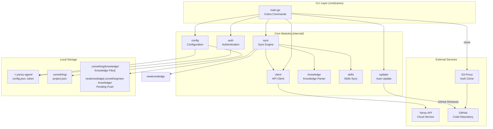
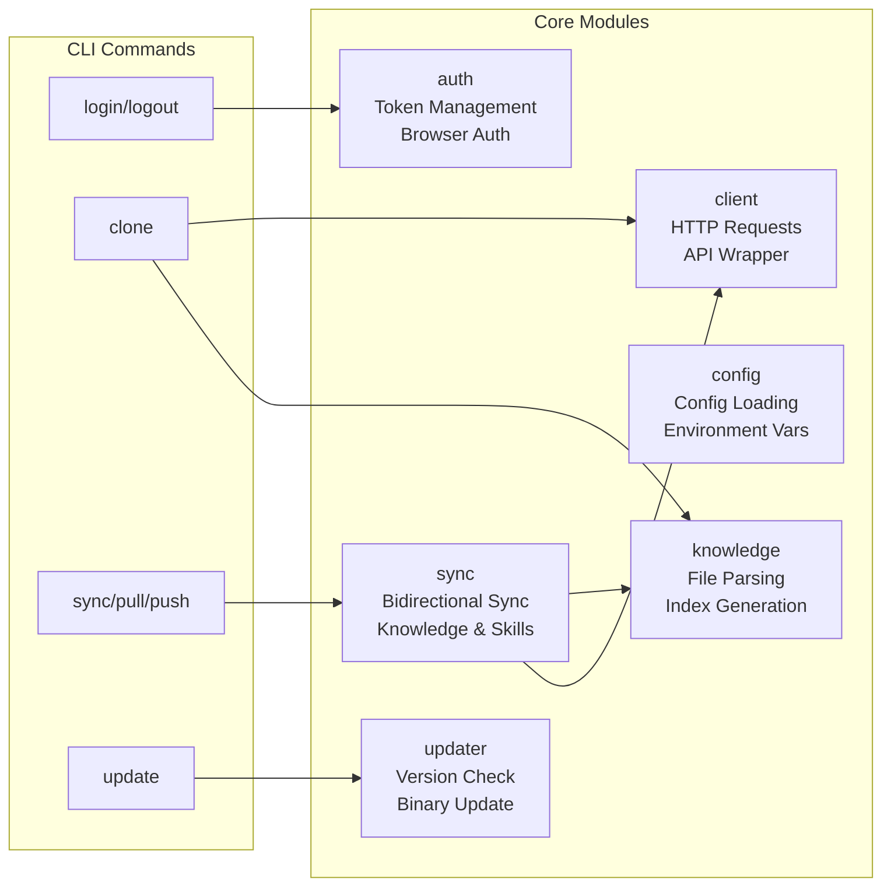
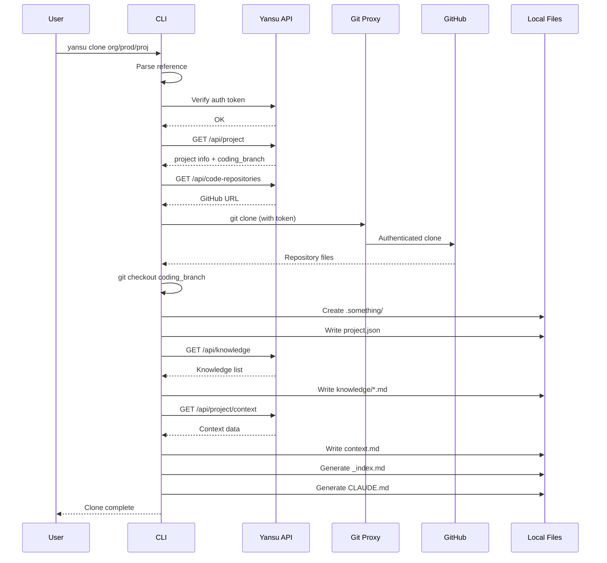
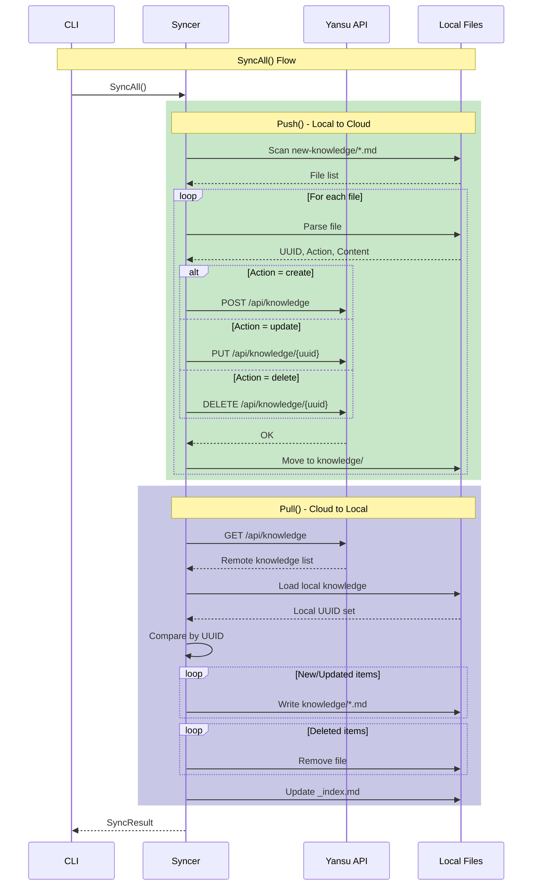
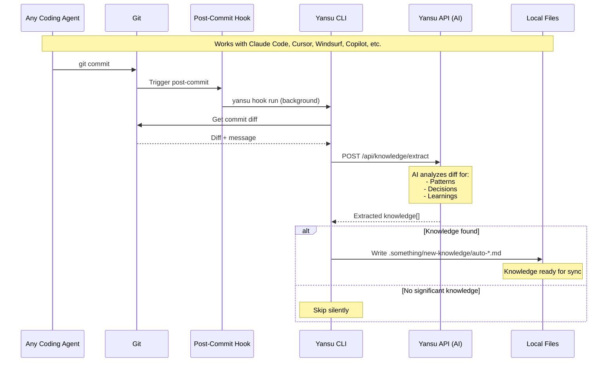

# Yansu Agent Architecture

This document describes the internal architecture of Yansu Agent for developers who need to maintain or extend the codebase.

## Overview

Yansu Agent is a local CLI tool that synchronizes project knowledge and context with the Yansu cloud platform. It enables AI coding assistants to understand project-specific patterns and requirements.

## High-Level Architecture



### Module Responsibilities



## Directory Structure

```
yansu-agent/
├── cmd/
│   └── yansu/
│       └── main.go              # CLI entry point, command definitions
├── internal/
│   ├── auth/
│   │   └── auth.go              # Login, logout, token management
│   ├── client/
│   │   └── api.go               # HTTP client for Yansu API
│   ├── config/
│   │   └── config.go            # Global and project configuration
│   ├── gitutil/
│   │   └── gitignore.go         # Git utilities for auto-gitignore
│   ├── knowledge/
│   │   ├── parser.go            # Knowledge file parsing and writing
│   │   └── index.go             # Index generation, context file
│   ├── skills/
│   │   ├── agents.go            # AI agent skill paths
│   │   ├── extractor.go         # Skill extraction to agent dirs
│   │   └── state.go             # Skills sync state
│   ├── sync/
│   │   └── sync.go              # Push/Pull synchronization logic
│   └── updater/
│       └── updater.go           # Self-update mechanism
├── scripts/
│   └── install.sh               # Installation script
├── Makefile                     # Build commands
└── go.mod                       # Go module definition
```

## Core Modules

### 1. CLI (`cmd/yansu/main.go`)

The entry point using [Cobra](https://github.com/spf13/cobra) for command-line parsing.

**Commands:**
| Command | Description |
|---------|-------------|
| `login` | Browser or token-based authentication |
| `logout` | Clear stored credentials |
| `status` | Show auth and project status |
| `clone` | Clone a project from cloud |
| `sync` | Manual bidirectional sync |
| `pull` | Pull latest from cloud |
| `push` | Push code and knowledge to remote |
| `analyze` | Analyze recent changes for knowledge |
| `hook` | Manage git hooks for auto knowledge capture |
| `update` | Self-update to latest version |

### 2. Authentication (`internal/auth/`)

Handles user authentication with the Yansu platform.

**Flow:**
```
Login()
  ├─ Check existing token
  ├─ Prompt for auth method (browser / manual token)
  ├─ Browser login:
  │   ├─ Start local HTTP server on 127.0.0.1
  │   ├─ Open browser to auth URL
  │   ├─ Wait for callback with token
  │   └─ Validate and save token
  └─ Token login:
      ├─ Prompt for token paste
      └─ Validate and save token
```

**Security:**
- Token stored in separate file (`~/.yansu-agent/token`) with 0600 permissions
- Config and token are separated for security

### 3. API Client (`internal/client/api.go`)

HTTP client for communicating with the Yansu backend.

**Key Methods:**
```go
// Project operations
GetProject(ctx, org, product, project) (*Project, error)
GetProjectCodeRepositories(ctx, org, product, project) ([]*CodeRepository, error)
GetProjectContext(ctx) (*ContextResponse, error)

// Knowledge CRUD
ListKnowledge(ctx) ([]*KnowledgeResponse, error)
CreateKnowledge(ctx, req) (*KnowledgeResponse, error)
UpdateKnowledge(ctx, uuid, req) (*KnowledgeResponse, error)
DeleteKnowledge(ctx, uuid) error

// Auth
Verify(ctx) error
```

**Key Structures:**
```go
type Project struct {
    UUID         string
    Name         string
    Organization string
    Product      string
    ProductUUID  string
    CodingBranch string    // Branch for coding (e.g., "feature/v27-abc123")
    CreatedAt    time.Time
}

type CodeRepository struct {
    UUID      string
    Name      string
    GitHubURL string    // GitHub repository URL
}
```

**API Endpoints:**
```
GET  /api/orgs/{org}/products/{product}/projects/{project}
GET  /api/orgs/{org}/products/{product}/projects/{project}/stages
GET  /api/public/orgs/{org}/products/{product}/projects/{project}/code-repositories
GET  /api/orgs/{org}/products/{product}/knowledge
POST /api/orgs/{org}/products/{product}/knowledge
POST /api/orgs/{org}/products/{product}/knowledge/extract  # AI knowledge extraction
PUT  /api/knowledge/{uuid}
DELETE /api/knowledge/{uuid}
GET  /api/auth/profile
```

### 4. Configuration (`internal/config/`)

Manages global and project-specific configuration.

**Global Config (`~/.yansu-agent/config.json`):**
```json
{
  "base_url": "https://dashboard.yansu.ai",
  "sync_interval_minutes": 5
}
```

The authentication token is stored separately in `~/.yansu-agent/token` (mode 0600) and is never written to `config.json`. Override the base URL with the `YANSU_URL` environment variable.

**Project Config (`.something/project.json`):**
```json
{
  "uuid": "proj_xxx",
  "name": "project-name",
  "organization": "org-name",
  "product": "product-name",
  "product_uuid": "prod_xxx",
  "yansu_url": "https://...",
  "created_at": "2024-01-01T00:00:00Z",
  "last_synced_at": "2024-01-02T10:30:00Z"
}
```

**Priority:** Environment variables > Config file > Defaults

### 5. Sync Engine (`internal/sync/`)

Handles bidirectional synchronization between local files and cloud.

**SyncAll Flow:**
```
SyncAll()
  ├─ Push() - Local → Cloud
  │   ├─ Scan new-knowledge/*.md
  │   ├─ Parse each file
  │   ├─ Execute action (create/update/delete)
  │   └─ Move to knowledge/ directory
  │
  ├─ Pull() - Cloud → Local
  │   ├─ Fetch remote knowledge list
  │   ├─ Compare with local (by UUID)
  │   ├─ Download new/updated items
  │   └─ Delete locally removed items
  │
  └─ PullSkills() - Sync skills to agent dirs
```

**Key Structures:**
```go
type SyncResult struct {
    Pushed       PushResult
    Pulled       PullResult
    SkillsPulled PullSkillsResult
}

type PushResult struct {
    Created []string  // Triggers of created knowledge
    Updated []string
    Deleted []string
    Errors  []string
}
```

### 6. Knowledge Parser (`internal/knowledge/`)

#### Parser (`parser.go`)

Parses and writes knowledge markdown files.

**Knowledge File Format:**
```markdown
# UUID
know_xxx

# Action
create

# Trigger
<trigger phrase for AI lookup>

# Content
<knowledge content>
```

**Key Functions:**
```go
ParseFile(filePath) (*Knowledge, error)
LoadAll(dir) ([]*Knowledge, error)
WriteKnowledgeFile(dir, uuid, trigger, content) error
DeleteKnowledgeFile(dir, uuid) error
```

#### Index (`index.go`)

Generates index and context files.

**`_index.md` Format:**
```markdown
# Knowledge Index

| Trigger | File |
|---------|------|
| error handling | error-handling.md |
| auth pattern | auth-pattern.md |
```

**`context.md` Format:**
```markdown
# Project Context

## Requirements
...

## Simulations
...
```

### 7. Updater (`internal/updater/`)

Self-update mechanism using GitHub Releases.

**Flow:**
```
Update(currentVersion, force)
  ├─ Fetch latest release from GitHub API
  ├─ Compare versions
  ├─ Download platform-specific binary
  └─ Replace current executable
```

## Data Flow

### Clone Flow



### Sync Flow



### Automatic Knowledge Capture Flow

The git hook provides coding-agent-agnostic, automatic knowledge capture:



**Key Features:**
- **Coding-agent agnostic**: Works with any AI tool that produces git commits
- **Non-blocking**: Runs in background, doesn't slow down commits
- **AI-powered**: Backend AI extracts meaningful patterns and decisions
- **Automatic**: No user intervention required after initial setup

## Local Directory Structure

After `yansu clone`, the project directory contains:

```
project-name/
├── .git/hooks/
│   └── post-commit           # Auto knowledge capture hook
├── .something/
│   ├── project.json          # Project metadata (read-only)
│   ├── context.md            # Project context (auto-generated)
│   ├── knowledge/            # Synced knowledge (read-only)
│   │   ├── _index.md         # Quick lookup index
│   │   ├── auth-pattern.md
│   │   └── error-handling.md
│   ├── new-knowledge/        # Create new knowledge here
│   │   ├── my-knowledge.md   # Will be pushed on next sync
│   │   └── auto-*.md         # Auto-generated by hook
│   ├── logs/                 # Hook execution logs
│   │   └── hook.log          # Debug info for auto capture
│   └── activity/             # Activity logs
│       └── 2024-01-15.md
├── CLAUDE.md                 # AI assistant instructions
└── ... (your code)
```

## Configuration Files

### Token Storage

```
~/.yansu-agent/
├── config.json    # Global settings (no secrets)
└── token          # Auth token (0600 permissions)
```

## Dependencies

```
github.com/spf13/cobra v1.8.0          # CLI framework
github.com/google/uuid v1.6.0          # UUID generation
```

## Error Handling

- All API errors are wrapped with context
- HTTP client has 30-second timeout
- File operations fail gracefully (log and continue)

## Security Considerations

1. **Token Storage**: Separate file with restrictive permissions (0600)
2. **HTTPS**: All API communication uses HTTPS
3. **Local Callback**: Browser auth callback only listens on 127.0.0.1
4. **Auth Timeout**: 5-minute timeout for browser authentication

## Future Improvements

- [ ] Implement activity logging API endpoint (backend)
- [ ] Add conflict detection for concurrent edits
- [ ] Add retry mechanism for failed API calls
- [ ] Support GitHub token for private repositories in clone
